  

### Merhaba, ben Yusuf 👋

Bilgisayar mühendisliği **4. sınıf öğrencisiyim**.
Yeni şeyler öğreniyor, denemeler yapıyor ve kendime uygun alanı keşfediyorum.

Bu profilde projelerimi ve öğrenme sürecimde geliştirdiğim çalışmaları paylaşacağım.

 

 

Merak et. Dene. Geliştir.

